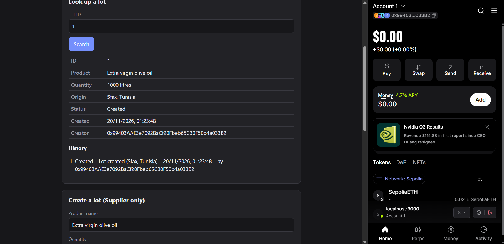
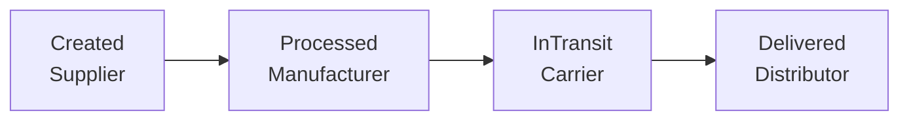

# Supply Chain Traceability on Ethereum

A prototype that tracks a lot of goods through a supply chain (Supplier → Manufacturer → Carrier → Distributor) using a Solidity smart contract, tested locally and deployed on the Ethereum **Sepolia** test network, with a small Web3 interface built with Ethers.js and MetaMask.

This is an academic project for a blockchain course, built by following a lab (TP) on blockchain traceability by Elyes Kooli, and documented step by step in the [`docs/`](docs) folder. It is a functional prototype, **not an audited or production-ready system**.



## What it does

- Creates lots of goods with a unique ID.
- Assigns roles to Ethereum addresses (Supplier, Manufacturer, Carrier, Distributor).
- Records each step of a lot with a location, a timestamp, the address of the actor and an optional document hash.
- Enforces the order of the steps and who may perform each one, inside the contract itself.
- Lets anyone read the state and full history of a lot.
- Emits events (`RoleAssigned`, `LotCreated`, `StepRecorded`) that an application can listen to.



## Tech stack

| Technology | Role |
|---|---|
| Solidity 0.8.x | Smart contract |
| Remix IDE | First compilation and deployment |
| Hardhat 3, Mocha, Ethers.js | Automated tests |
| MetaMask | Wallet and transaction signing |
| HTML, CSS, JavaScript, Ethers.js 6 | Web interface |
| Sepolia | Public Ethereum test network |

## Repository structure

```
supply-chain-dapp/
├── contracts/SupplyChain.sol   the smart contract
├── test/SupplyChain.ts         25 automated tests
├── frontend/                   web interface (index.html, app.js, abi.js, config.js, style.css)
├── docs/                       step-by-step documentation and screenshots
├── hardhat.config.ts           Hardhat configuration
└── package.json
```

## Deployed instance (Sepolia)

| Item | Value |
|---|---|
| Network | Sepolia (chain ID 11155111) |
| Contract address | `0x0e236F0C90e51D4Fe4fd829522C306543EAEEd72` |
| Deployment transaction | `0xae621712f28412410f5fec948e9fba2d9c55857001e3e6ab05caaa7f403f3c05` |

Both can be inspected on <https://sepolia.etherscan.io/>.

## Getting started

### Prerequisites

- Node.js 22.13 or later
- The MetaMask browser extension, with a **test-only** account
- Test ETH from a Sepolia faucet, only if you want to send transactions

### Compile and test the contract

```bash
npm install
npx hardhat compile
npx hardhat test
```

All 25 tests should pass. The last test prints a table with the gas used by each operation.

### Run the web interface

1. In `frontend/config.js`, set `CONTRACT_ADDRESS` to the contract you want to use (the Sepolia address above is already the default if you kept it).
2. Serve the folder:

   ```bash
   cd frontend
   npx serve
   ```

3. Open the printed address (usually <http://localhost:3000>), switch MetaMask to Sepolia and click **Connect MetaMask**.

Reading a lot is free. Creating a lot or recording a step is a transaction that needs the right role and a little test ETH. In Brave, set the default wallet to MetaMask in `brave://settings/web3`, otherwise Brave Wallet may take over.

### Deploy your own instance

Compile and deploy `contracts/SupplyChain.sol` from Remix, using a Remix VM environment for local trials, or **Browser Wallet** (Remix Desktop) or **Injected Provider - MetaMask** (web Remix) for Sepolia. Then put the new address in `frontend/config.js`. Roles must be assigned from the deployer account with `assignRole` (1 = Supplier, 2 = Manufacturer, 3 = Carrier, 4 = Distributor).

## Results in brief

| Indicator | Result |
|---|---|
| Automated tests | 25 / 25 pass |
| Forbidden operations rejected | 23 / 23 in the tests |
| Full lifecycle (4 steps) | Verified locally and in the tests |
| Time to create a lot on Sepolia | 12.6 s (one measurement) |
| Time to read a lot on Sepolia | 315 to 563 ms |
| Gas for `createLot` | 315,112 locally, about 1.37 million on Sepolia |
| Gas for deployment | 2.49 million locally, about 17.5 million on Sepolia |

The large difference between local and Sepolia gas is explained and discussed in [`docs/08-evaluation.md`](docs/08-evaluation.md).

## Documentation

| Document | Content |
|---|---|
| [`01-environment.md`](docs/01-environment.md) | MetaMask and Remix setup |
| [`02-contract-design.md`](docs/02-contract-design.md) | Lifecycle, data model, functions, design decisions |
| [`03-local-simulation.md`](docs/03-local-simulation.md) | Local deployment and a full logistics simulation |
| [`04-security-tests.md`](docs/04-security-tests.md) | Manual tests of the access-control and transition rules |
| [`05-sepolia-deployment.md`](docs/05-sepolia-deployment.md) | Deployment on the Sepolia test network |
| [`06-web3-interface.md`](docs/06-web3-interface.md) | The Ethers.js web interface |
| [`07-hardhat-tests.md`](docs/07-hardhat-tests.md) | Automated tests and gas usage |
| [`08-evaluation.md`](docs/08-evaluation.md) | Measurements and local versus Sepolia comparison |
| [`09-architecture.md`](docs/09-architecture.md) | Towards an industrial architecture and governance |

## Known limitations

- The contract owner can change any role at any time, and there is no revocation process.
- Roles are global: any Carrier can move any lot.
- The Distributor confirms delivery alone, without validation from the recipient.
- Steps cannot be corrected; there is no dispute mechanism.
- Text is stored directly on-chain, which is costly and publicly readable.
- On Sepolia, only the Supplier account was used; the other roles were tested locally.
- The contract has not been audited.
- A blockchain makes records verifiable but cannot prove that the physical facts entered (a truck carried the goods, a certificate is valid) are true.

## Security notes

- Use a dedicated MetaMask account with test funds only.
- Never share or commit a recovery phrase or private key. This repository contains none: `config.js` only holds a public contract address.
- Keep any future `.env` file out of version control.

## License

The smart contract carries an MIT SPDX license identifier.
