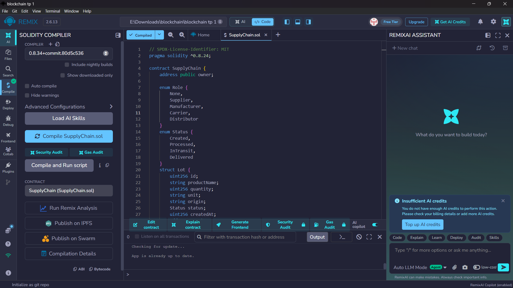

# 02 – Contract Design

## Goal

`SupplyChain.sol` is a Solidity smart contract that tracks a lot of goods (for example, olive oil) as it moves through four actors: Supplier, Manufacturer, Carrier and Distributor. Every step is stored on Ethereum with a timestamp and the address of the actor who recorded it, so the history of a lot can be checked later.

## Lot lifecycle

A lot moves through four states, always in the same order:

`Created → Processed → InTransit → Delivered`

| New state | Who can set it | Required current state | Function |
|---|---|---|---|
| Created | Supplier | none (new lot) | `createLot` |
| Processed | Manufacturer | Created | `recordStep` |
| InTransit | Carrier | Processed | `recordStep` |
| Delivered | Distributor | InTransit | `recordStep` |

Any other combination is rejected by the contract, for example a Carrier trying to mark a lot as Delivered, or a lot jumping from Created to InTransit.

## Data model

**Enums**

- `Role`: None (0), Supplier (1), Manufacturer (2), Carrier (3), Distributor (4). Solidity stores enums as numbers, so when calling `assignRole` from Remix the role is typed as a number.
- `Status`: Created (0), Processed (1), InTransit (2), Delivered (3).

**Structs**

- `Lot`: `id`, `productName`, `quantity`, `unit`, `origin`, `status`, `createdAt`, `creator`, `exists`. The `exists` flag lets the contract tell a real lot from an empty mapping entry.
- `Step`: `description`, `location`, `timestamp`, `actor`, `documentHash`, `status`. One `Step` is one entry in a lot's history.

**Storage**

- `owner`: the address that deployed the contract.
- `nextLotId`: counter starting at 1, incremented for each new lot.
- `roles`: maps an address to its `Role` (public).
- `lots`: maps a lot ID to its `Lot` (private).
- `history`: maps a lot ID to an array of `Step` (private).

`private` in Solidity only means other contracts cannot read the variable directly. The data is still visible on a public blockchain, and the contract exposes it through getter functions.

## Functions

| Function | Access | Purpose |
|---|---|---|
| `constructor` | runs once at deployment | Sets the deployer as `owner` and gives it the Supplier role |
| `assignRole(actor, role)` | owner only | Gives an address a role; rejects the zero address and `Role.None` |
| `createLot(...)` | Supplier only | Validates name, quantity and unit, creates the lot, records the first history step |
| `recordStep(...)` | depends on the new status | Checks caller role and current lot state, then updates the status and appends a history step |
| `getLot(lotId)` | anyone (read-only) | Returns the current lot data |
| `getHistoryCount(lotId)` | anyone (read-only) | Returns the number of recorded steps |
| `getHistoryStep(lotId, index)` | anyone (read-only) | Returns one step; rejects an invalid index |

Reusable checks are written as modifiers: `onlyOwner`, `onlyRole(...)` and `lotExists(...)`. Each runs a `require` before the function body.

## Events

The contract emits three events, which are written to the transaction logs and can be used by a web application to update a dashboard:

- `RoleAssigned(actor, role)`
- `LotCreated(lotId, productName, creator)`
- `StepRecorded(lotId, status, actor, location, timestamp)`

## Design decisions

- **Rules are enforced in the contract, not in the interface.** Anyone can call the contract directly with any data, bypassing a web page. Putting the role and transition checks in the contract means they cannot be skipped.
- **Each history step stores the actor's address and a timestamp.** This lets anyone check which Ethereum account recorded each operation and when.
- **`documentHash` links a step to an off-chain document.** The hash of a delivery note or quality certificate can be stored on-chain while the document stays in private storage. Recomputing the hash later and comparing it proves the document was not changed (integrity). It does not prove the document was genuine in the first place (authenticity), because the contract only stores whatever hash it is given.
- **A single owner manages roles.** This keeps the prototype simple.

## Known limitations

- The owner can change any role at any time, and there is no revocation process, owner replacement or log of rights changes beyond the `RoleAssigned` event.
- Any account with the Carrier role can move any lot; roles are global, not assigned per lot.
- The Distributor alone confirms delivery, with no validation from the recipient.
- Everything on a public blockchain is publicly readable, so confidential data should not be stored on-chain.
- The blockchain makes the records verifiable, but it cannot prove that the physical facts entered (a truck really carried the goods, a certificate is valid) are true.

## Compilation

- Compiler version used: 0.8.34 (compatible with the contract's `pragma solidity ^0.8.24;`)
- Result: compiled successfully, no errors

- Problems encountered and fixes: none