# 03 – Local Deployment and Logistics Simulation

This document covers TP sections 7 and 8: deploying `SupplyChain.sol` on the simulated blockchain of Remix, then playing the four actors of the supply chain with different test accounts to follow one lot from creation to delivery.

## 1. Local deployment

The contract was deployed on the **Remix VM**, a temporary in-browser blockchain. It needs no real ETH, no wallet and no configuration, and its data is not published on any public network.

### Steps

1. Open the **Deploy & Run Transactions** panel.
2. Select a **Remix VM** environment.
3. Check that the selected contract is `SupplyChain` (`contracts/SupplyChain.sol`).
4. Click **Deploy**. The constructor takes no arguments.
5. Expand the contract under **Deployed Contracts**.

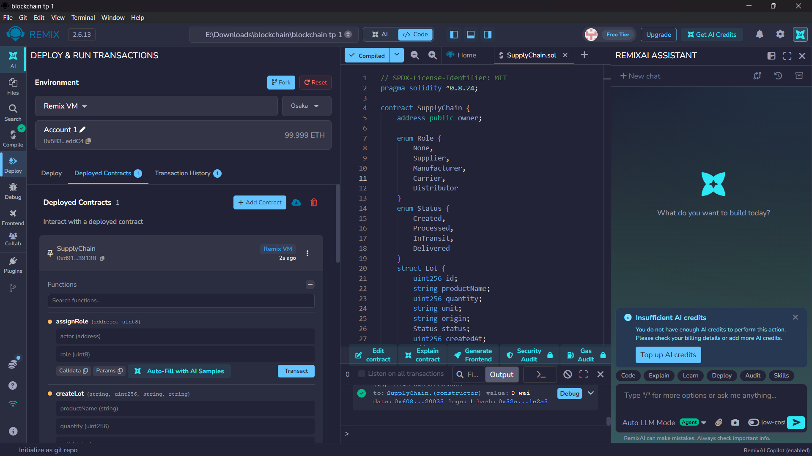

### Initial state checks

After deployment, the public getters were used to check the initial state:

| Check | Expected result | Why |
|---|---|---|
| `owner` | address of Account 1 (the deployer) | The constructor sets `owner = msg.sender` |
| `nextLotId` | `1` | The counter starts at 1 |
| `roles(<Account 1 address>)` | `1` (Supplier) | The constructor gives the deployer the Supplier role |

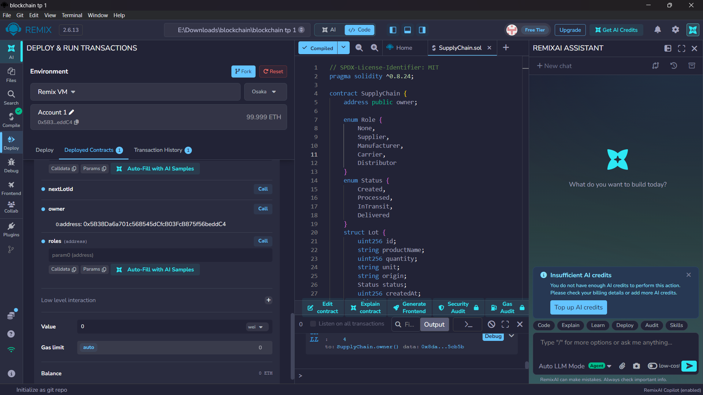
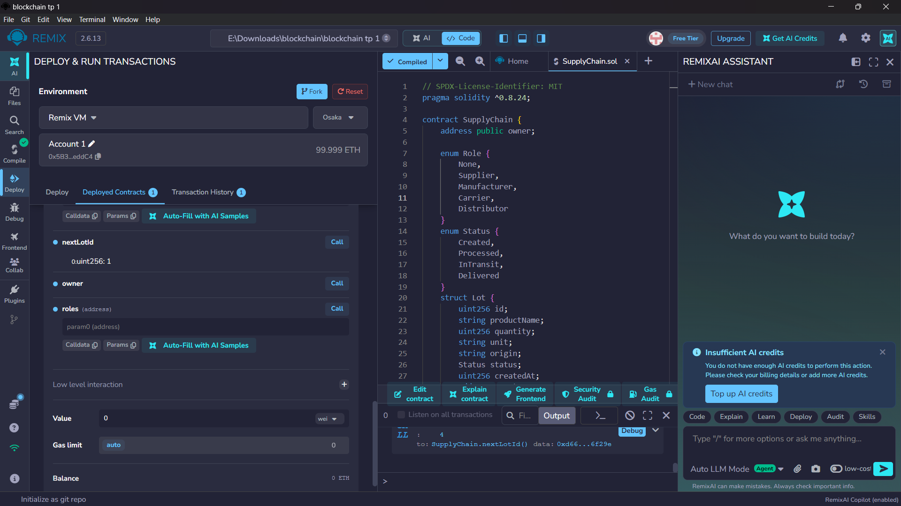
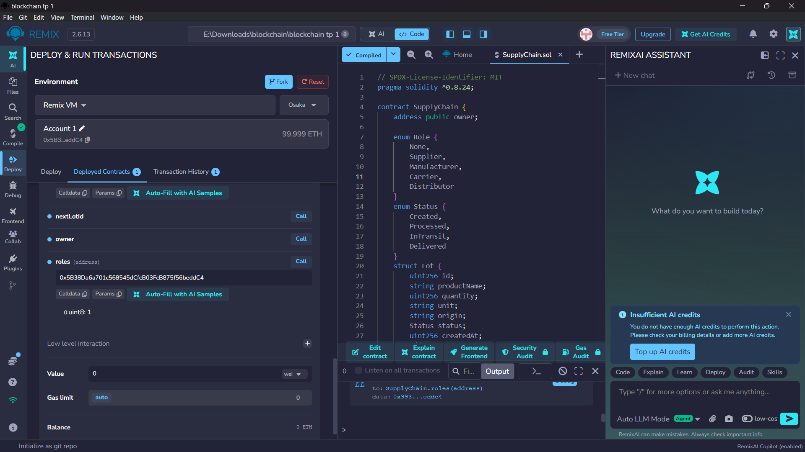

> The Remix VM is temporary. Reloading the page erases the deployed contract and all its data, so the whole simulation below has to be done in one session.

## 2. Test accounts and roles

Four of the accounts provided by Remix represent the actors of the chain. The deployer (Account 1) is already the Supplier and is also the contract owner, which is the only account allowed to call `assignRole`.

| Account | Role | `Role` value |
|---|---|---|
| Account 1 | Supplier (and owner) | 1, assigned by the constructor |
| Account 2 | Manufacturer | 2 |
| Account 3 | Carrier | 3 |
| Account 4 | Distributor | 4 |

### Assigning the roles

From Account 1 (the owner), `assignRole(actor, role)` was called three times:

1. Account 2's address with role `2`
2. Account 3's address with role `3`
3. Account 4's address with role `4`

Each call emits a `RoleAssigned` event, visible in the Remix terminal.

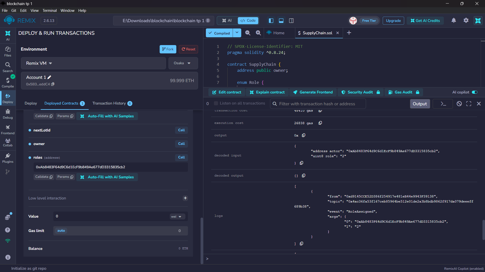
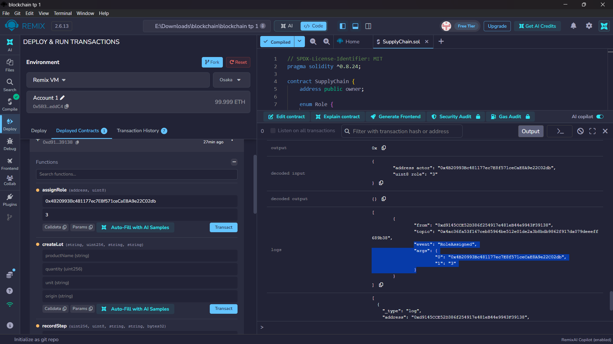
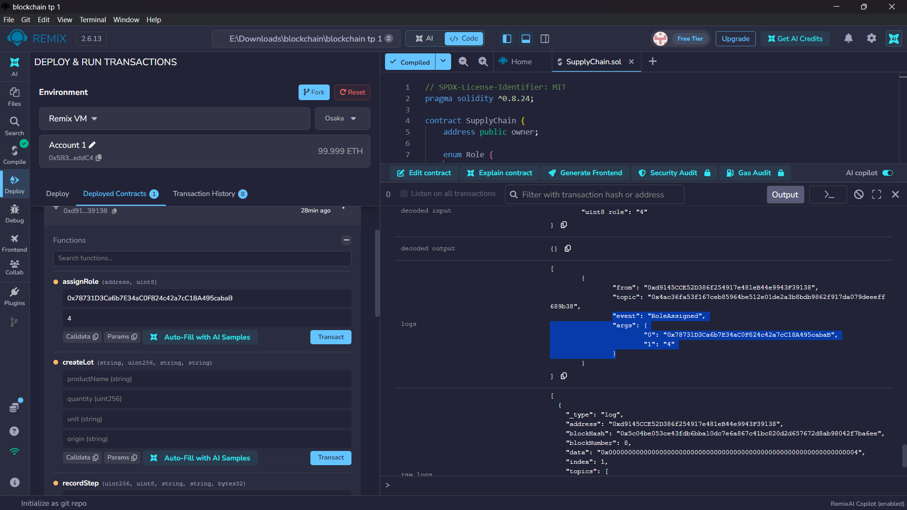

## 3. Following one lot through the chain

The example lot is a batch of olive oil, following the TP's case study.

### Step 1 – Creation (Supplier, Account 1)

`createLot` was called with:

| Parameter | Value |
|---|---|
| `productName` | Huile d'olive extra vierge |
| `quantity` | 1000 |
| `unit` | litres |
| `origin` | Sfax, Tunisie |

The lot receives ID `1`, because `nextLotId` started at 1. The contract also writes the first history step automatically and emits `LotCreated` and `StepRecorded`. Calling `getLot(1)` returns the stored data with status `0` (Created).

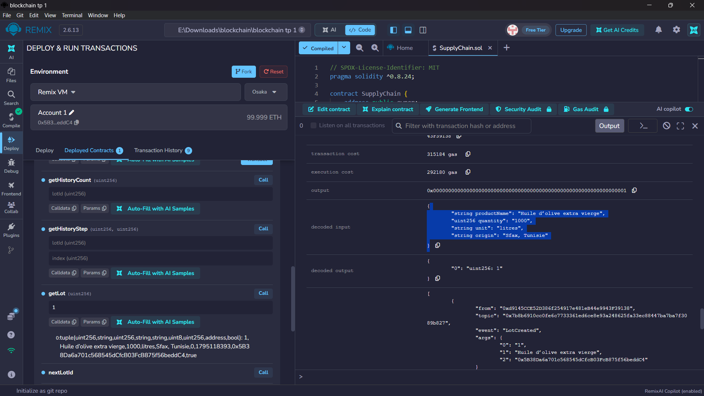

### Step 2 – Processing (Manufacturer, Account 2)

`recordStep` was called with:

| Parameter | Value |
|---|---|
| `lotId` | 1 |
| `newStatus` | 1 (Processed) |
| `description` | Conditionnement et contrôle qualité |
| `location` | Sfax, Tunisie |
| `documentHash` | `0x` followed by 64 zeros (no document attached) |

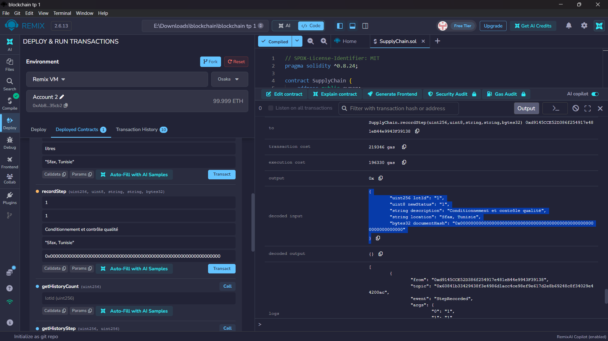

### Step 3 – Transport (Carrier, Account 3)

| Parameter | Value |
|---|---|
| `lotId` | 1 |
| `newStatus` | 2 (InTransit) |
| `description` | Prise en charge de la marchandise |
| `location` | Sfax – Tunis |
| `documentHash` | `0x` followed by 64 zeros |

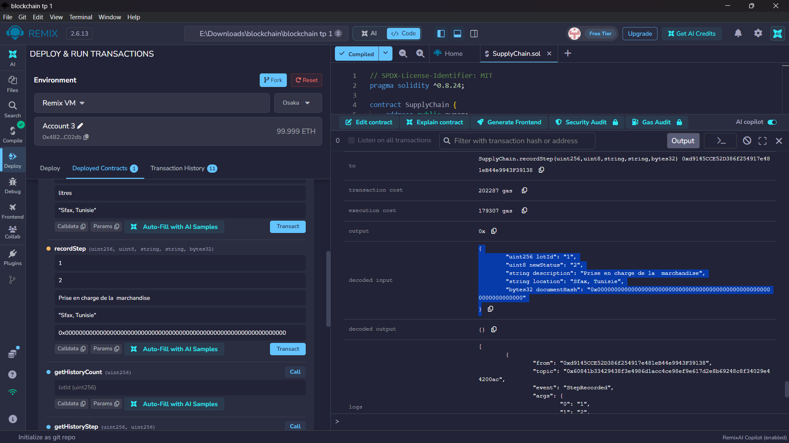

### Step 4 – Delivery (Distributor, Account 4)

| Parameter | Value |
|---|---|
| `lotId` | 1 |
| `newStatus` | 3 (Delivered) |
| `description` | Réception et contrôle du lot |
| `location` | Tunis, Tunisie |
| `documentHash` | `0x` followed by 64 zeros |

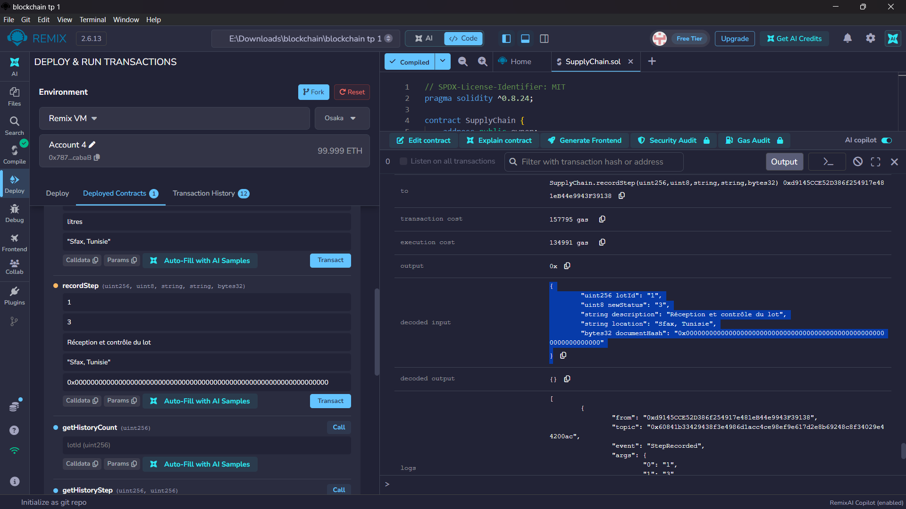

The order and the account used at each step matter: the contract rejects a step if the caller does not have the required role or if the lot is not in the required previous state. These rejections are tested separately in the security tests document.

## 4. Verifying the history

After the delivery, the read-only functions were used to check the result:

| Call | Expected result |
|---|---|
| `getLot(1)` | Lot data with status `3` (Delivered) |
| `getHistoryCount(1)` | `4` |
| `getHistoryStep(1, 0)` | Lot created (Supplier, Sfax, Tunisie) |
| `getHistoryStep(1, 1)` | Processing (Manufacturer, Sfax, Tunisie) |
| `getHistoryStep(1, 2)` | Transport (Carrier, Sfax – Tunis) |
| `getHistoryStep(1, 3)` | Delivery (Distributor, Tunis, Tunisie) |

Each step shows the address of the account that recorded it and the timestamp of its transaction, which lets anyone check who did what and when.

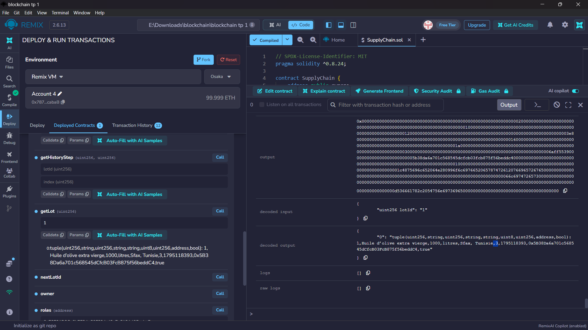

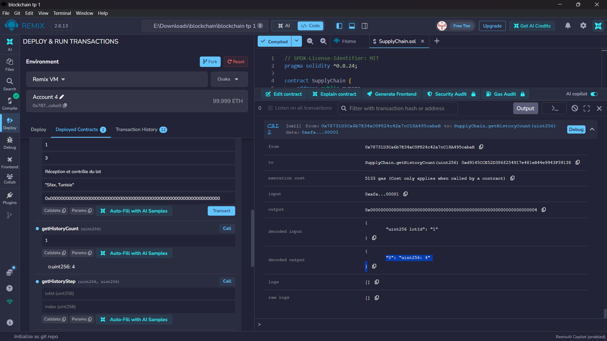
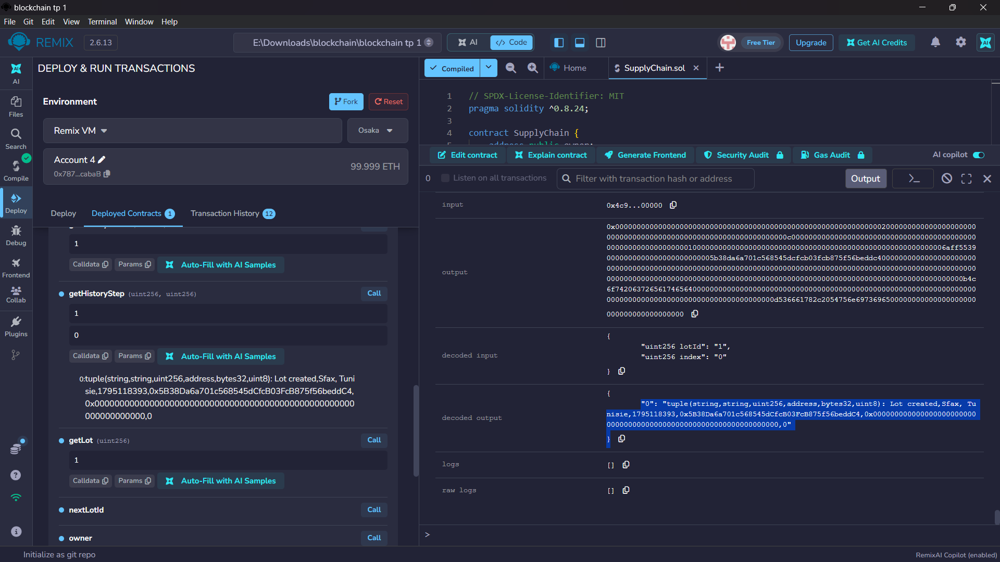
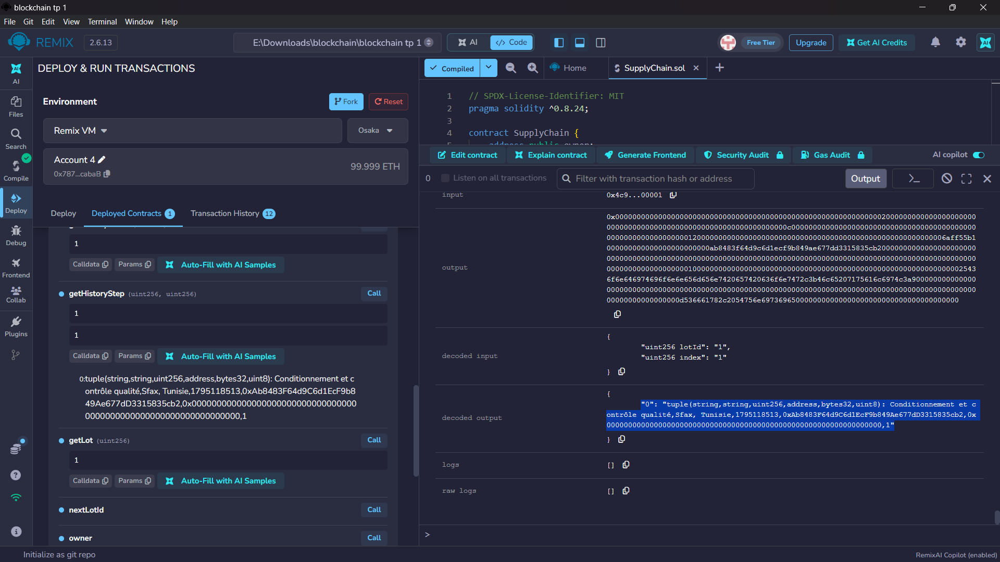
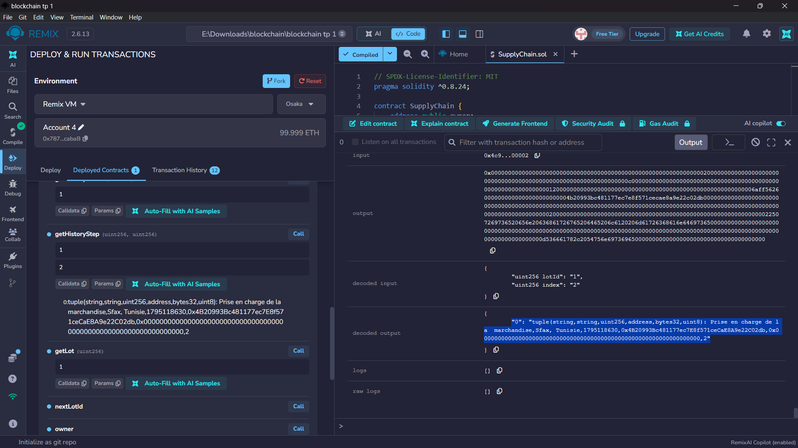
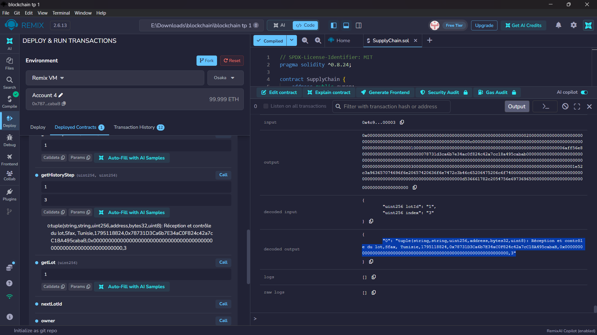

## 5. Observations

- The lot went through all four states in the intended order, with one account per role, and the full history is readable from the contract.
- Read functions (`getLot`, `getHistoryCount`, `getHistoryStep`) are free to call, while `assignRole`, `createLot` and `recordStep` are transactions that change the blockchain state.
- The `documentHash` field was left empty in this simulation. In a real use, it would hold the hash of a delivery note or a quality certificate.
- The simulation shows that the records are consistent and attributable to addresses. It does not prove that the physical operations really took place, since the contract only stores what the actors submit.

## Next

The next document tests the security rules: unauthorized callers, invalid inputs and forbidden state transitions.
