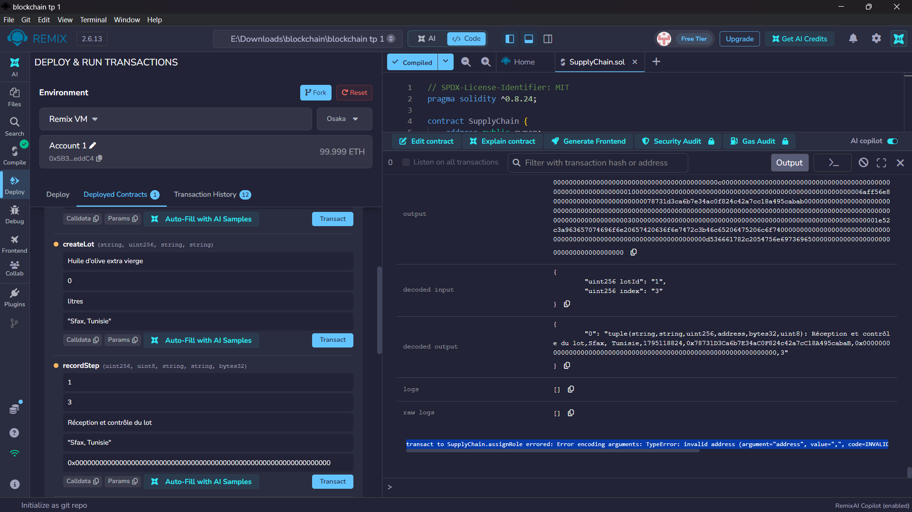
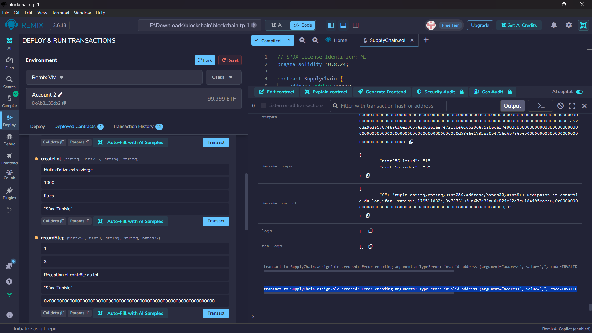
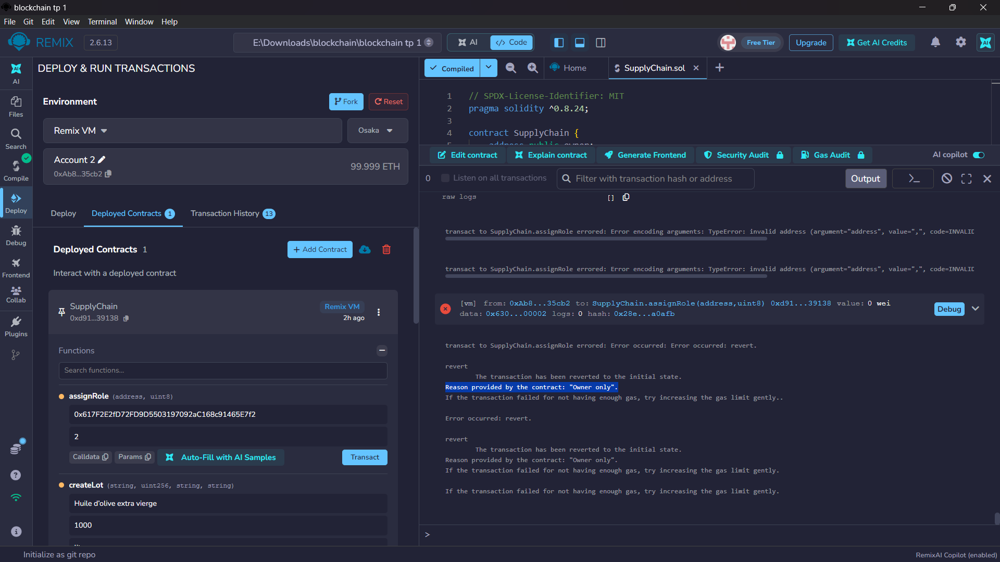
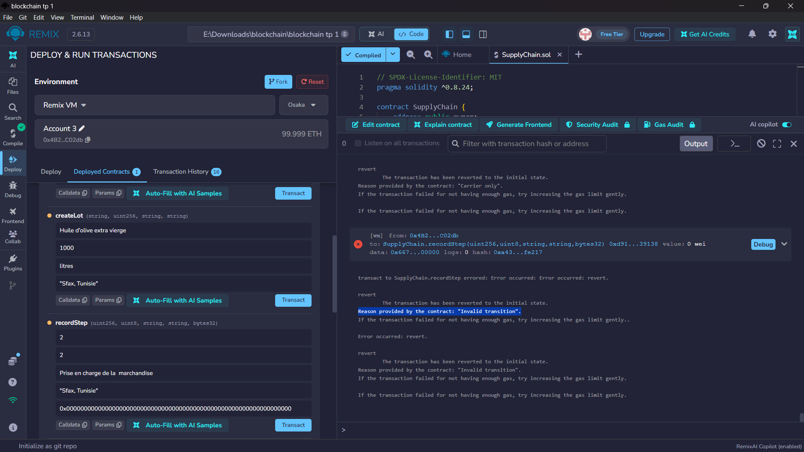
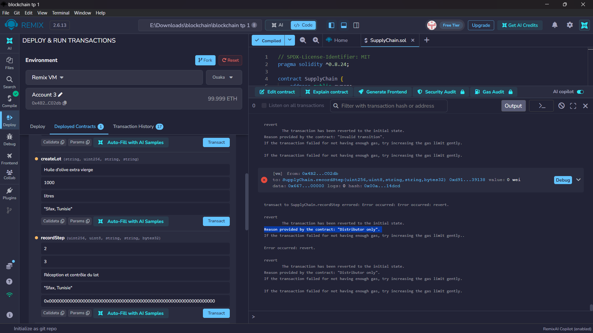
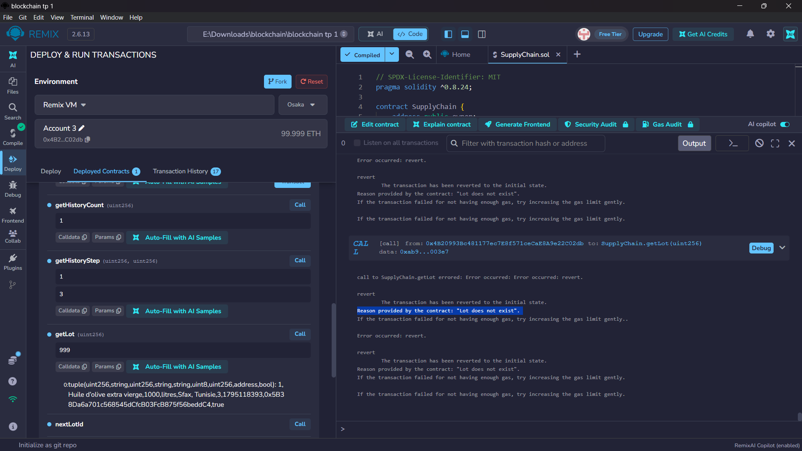
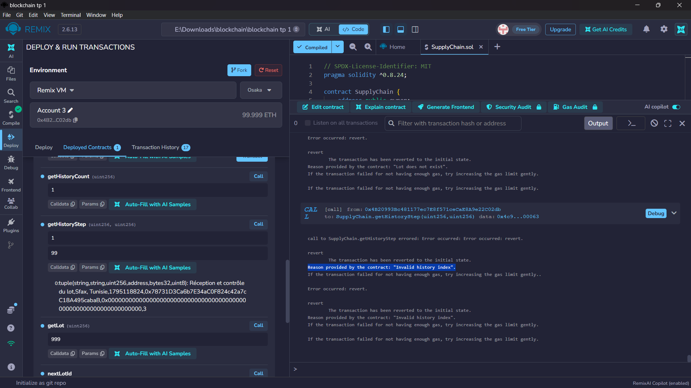
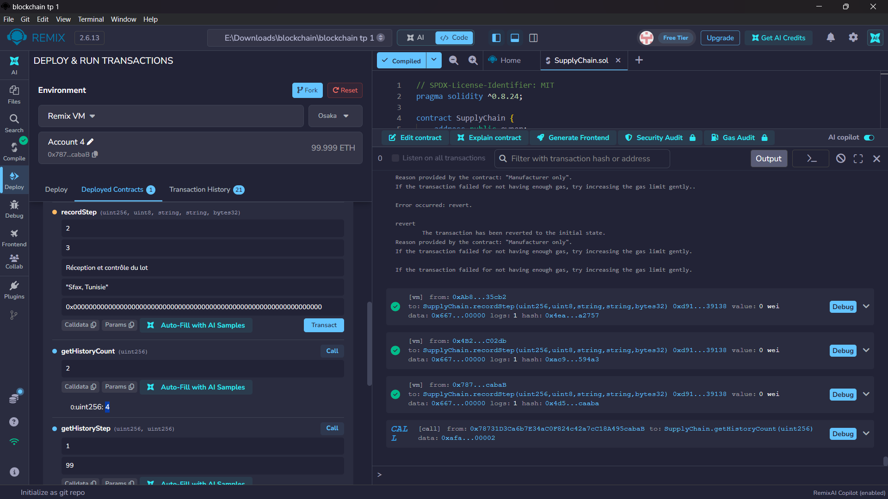

# 04 – Security Tests

This document covers TP section 9. The goal is to check that `SupplyChain.sol` enforces its access-control rules and state-transition rules: unauthorized callers, invalid inputs and forbidden transitions must be rejected, and the correct sequence must succeed.

The tests were run on the Remix VM, in the same session as the logistics simulation (see `03-local-simulation.md`). Lot 1 was already in the Delivered state, so a second lot (lot 2) was created from the Supplier account for the tests that need a lot in an earlier state.

## Test accounts

| Account | Role |
|---|---|
| Account 1 | Owner and Supplier |
| Account 2 | Manufacturer |
| Account 3 | Carrier |
| Account 4 | Distributor |

## Summary of results

| Test | Account | Action | Expected result | Revert reason |
|---|---|---|---|---|
| T1 | Account 1 | Create a lot with quantity `0` | Fails | `Quantity must be positive` |
| T2 | Account 2 | Create a lot without the Supplier role | Fails | `Unauthorized role` |
| T3 | Account 2 | Assign a role without being the owner | Fails | `Owner only` |
| T4 | Account 3 | Move lot 2 to InTransit before it is Processed | Fails | `Invalid transition` |
| T5 | Account 3 | Mark a lot as Delivered with the Carrier role | Fails | `Distributor only` |
| T6 | any | Read a lot ID that does not exist (`getLot(999)`) | Fails | `Lot does not exist` |
| T7 | any | Read a history index that does not exist (`getHistoryStep(1, 99)`) | Fails | `Invalid history index` |
| T8 | Accounts 1 to 4 | Run the full cycle on lot 2 with the right accounts and order | Succeeds | none |

In Remix, a failing transaction often triggers a warning that gas estimation failed. The transactions were sent anyway so that the revert and its reason appear in the terminal.

## Detailed tests

### T1 – Lot with a null quantity

**Action:** from Account 1 (Supplier), call `createLot` with a valid name, quantity `0`, a unit and an origin.

**Rule tested:** `require(quantity > 0, "Quantity must be positive")` in `createLot`.

**Result:** the transaction reverted with `Quantity must be positive`, and no lot was created.

### T2 – Lot creation without the Supplier role

**Action:** from Account 2 (Manufacturer), call `createLot` with valid values.

**Rule tested:** the `onlyRole(Role.Supplier)` modifier on `createLot`.

**Result:** the transaction reverted with `Unauthorized role`. Having a role in the system is not enough; it must be the right one.

### T3 – Role assignment by a non-owner

**Action:** from Account 2, call `assignRole` with an address and a role.

**Rule tested:** the `onlyOwner` modifier on `assignRole`.

**Result:** the transaction reverted with `Owner only`. This happened by accident during the simulation (the wrong account was selected), which confirmed that the access control works.

### T4 – Transport before processing

**Action:** from Account 3 (Carrier), call `recordStep` on lot 2 with status `2` (InTransit) while the lot is still in the Created state.

**Rule tested:** in `recordStep`, a transition to InTransit requires the current status to be Processed.

**Result:** the transaction reverted with `Invalid transition`. The role is correct, but the lot is not in the required previous state.

### T5 – Delivery by a Carrier

**Action:** from Account 3 (Carrier), call `recordStep` with status `3` (Delivered).

**Rule tested:** in `recordStep`, a transition to Delivered requires the Distributor role.

**Result:** the transaction reverted with `Distributor only`. The contract checks the caller's role before the lot's state, so a legitimate Carrier is rejected on the role even before the state is considered.

### T6 – Nonexistent lot

**Action:** call `getLot(999)`.

**Rule tested:** the `lotExists` modifier.

**Result:** the call reverted with `Lot does not exist`.

### T7 – Nonexistent history index

**Action:** call `getHistoryStep(1, 99)`, while lot 1 has only four steps.

**Rule tested:** `require(index < history[lotId].length, "Invalid history index")`.

**Result:** the call reverted with `Invalid history index`.

### T8 – Full valid cycle

**Action:** on lot 2, run the complete sequence with the right accounts in the right order:

1. Account 2 records Processed
2. Account 3 records InTransit
3. Account 4 records Delivered

**Result:** all transactions succeeded. `getLot(2)` shows status `3` (Delivered) and `getHistoryCount(2)` returns `4`.

## Observations

- Access control and state transitions are enforced by the contract itself. A user cannot get around them by sending different data, because the checks run on-chain whatever interface is used.
- Rejected transactions leave the state unchanged: no lot was created in T1 and T2, and no status changed in T4 and T5.
- Each revert message identifies which rule was violated, which makes the failures easy to interpret.

## Limits of these tests

These tests show that the access control and the transition rules work on the cases listed. They are not a full security audit. In particular, they do not cover:

- **Owner privileges.** In this version, the owner can change any role at any time, including the roles of existing accounts. A professional version would need controlled administration, role revocation, a procedure to replace the owner, and a log of rights changes.
- **Delivery confirmation.** The Distributor can confirm delivery alone. It should be decided whether the recipient must validate the reception as well.
- **Global roles.** Any Carrier can move any lot, because roles are not assigned per lot.
- **Truthfulness of the data.** The contract guarantees that records are consistent and attributable to an address. It cannot guarantee that the physical facts entered (a truck carried the goods, a certificate is valid) are true.
- **Other test categories.** Simultaneous calls, role revocation and administration changes are not tested here and would be part of the automated tests developed with Hardhat later.

## Next

The next step is deploying the contract to the Sepolia test network with MetaMask.
