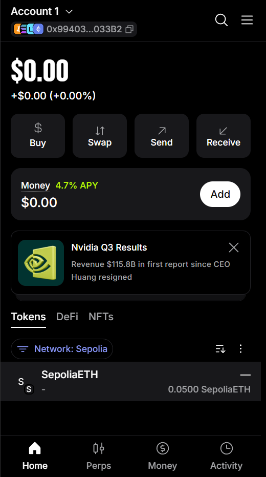
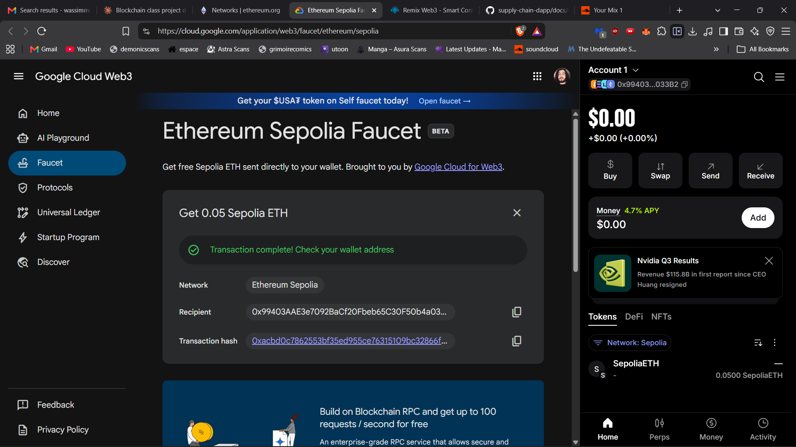
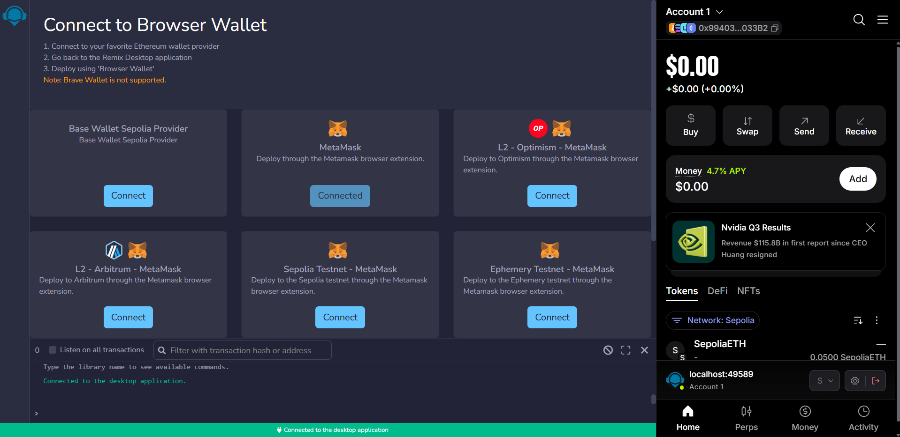
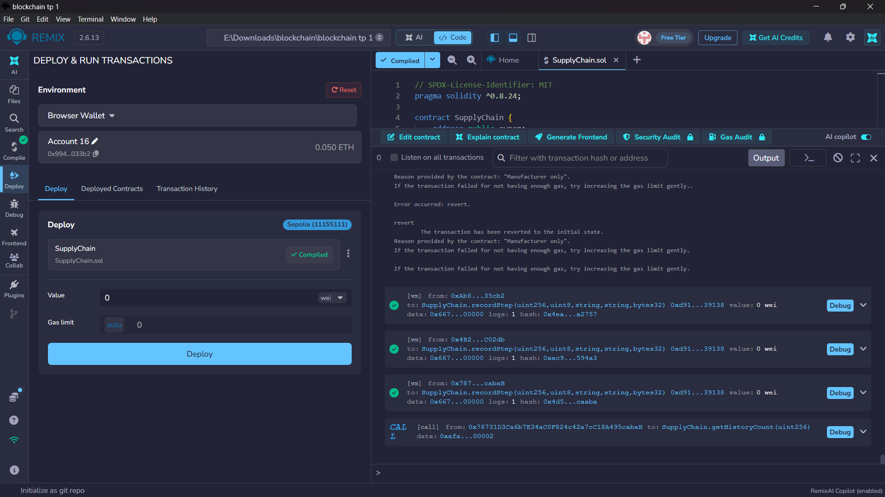
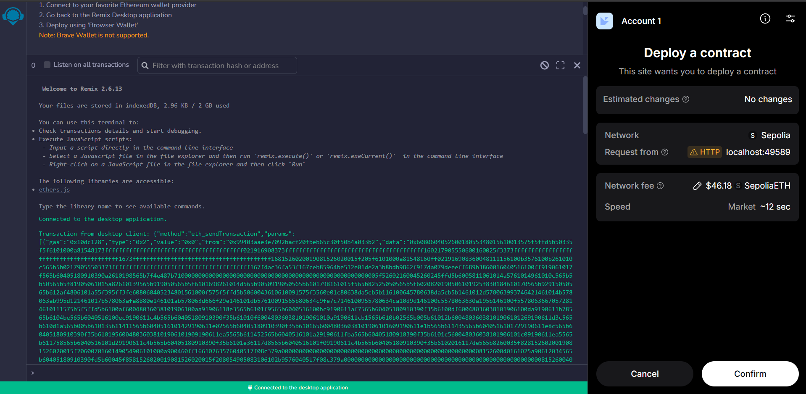
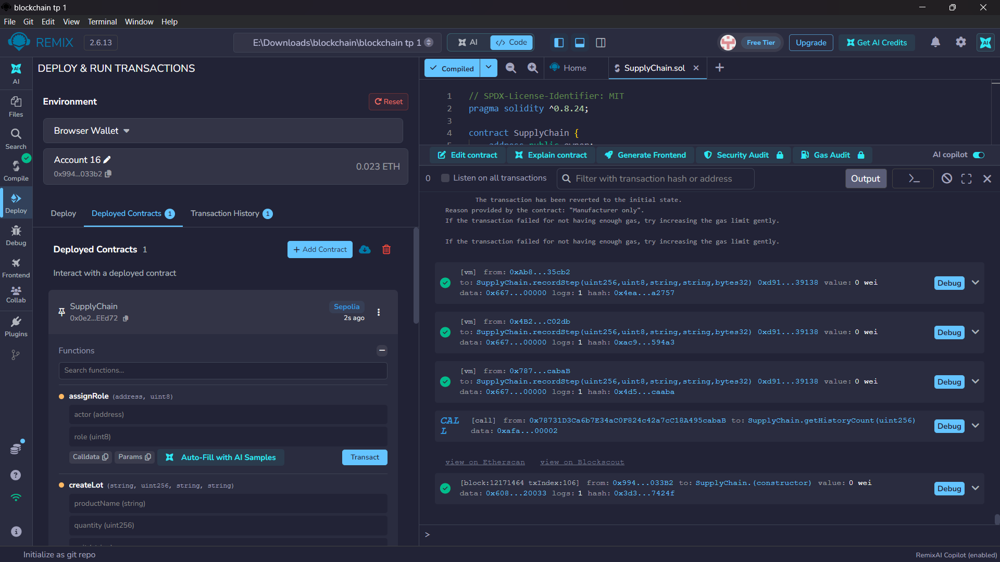
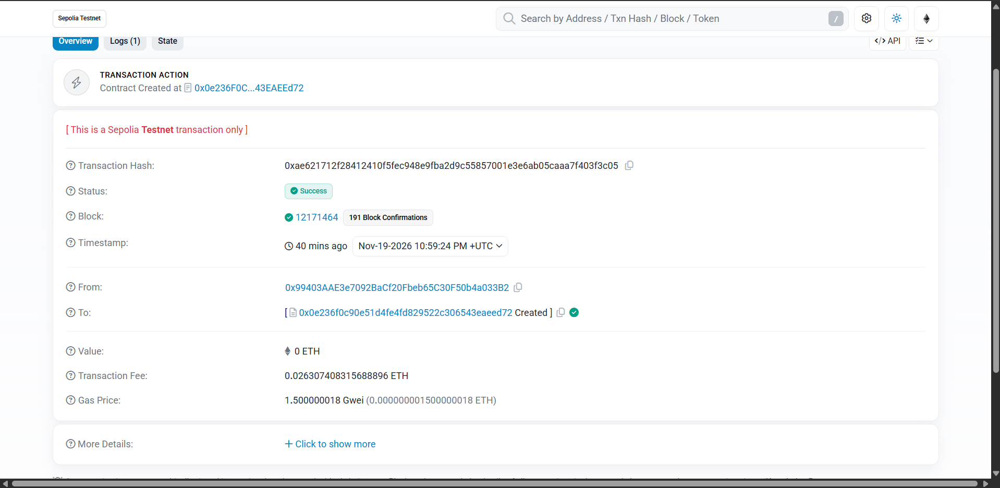
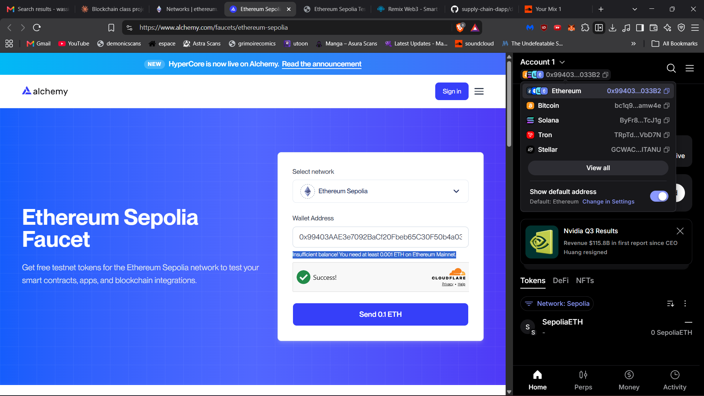
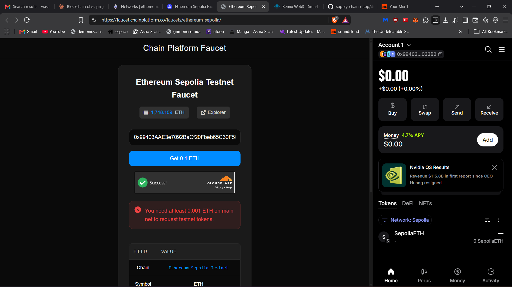

# 05 – Deployment on the Sepolia Test Network

This document covers TP section 10. After validating `SupplyChain.sol` locally on the Remix VM, the contract was deployed on **Sepolia**, a public Ethereum test network, using MetaMask as the wallet and Remix as the deployment tool.

Sepolia transactions use test ETH, which has no monetary value, but they still consume gas like on the main network. The deployed contract is a new instance, distinct from the local one: the lots created on the Remix VM are not transferred to Sepolia.

## 1. Preparation

### Wallet

A dedicated MetaMask account was used for this project only. It holds no real funds, and its recovery phrase and private key are not stored anywhere in this repository.

1. MetaMask was switched to the **Sepolia** network.
2. The address of the test account was copied.

### Test ETH

Test ETH was requested from a Sepolia faucet. Only the public wallet address is needed for this. The balance was checked in MetaMask before deploying, to make sure it covered the gas fees of the deployment and of later transactions.

### Remix

The contract was compiled again in Remix with a compiler version compatible with `pragma solidity ^0.8.24;` (compiler used: 0.8.34).

## 2. Deployment

1. In **Deploy & Run Transactions**, the environment was set to **Browser Wallet - MetaMask**,which connects Remix Desktop to the MetaMask extension.
2. The connection to MetaMask was authorized.
3. The network shown by Remix was checked: Sepolia, chain ID 11155111.
4. The account shown was checked: the dedicated MetaMask test account.
5. `SupplyChain` was selected and **Deploy** was clicked.
6. The transaction was confirmed in MetaMask.

A deployment is an Ethereum transaction that stores the contract code on the selected network. It costs gas even on a test network.

## 3. Deployment information

| Item | Value | Where it comes from
|---|---|---|
| Network | Sepolia | MetaMask confirmation screen
| Chain ID | 11155111 | Remix’s Deploy panel tag
| Contract address | `0x0e236F0C90e51D4Fe4fd829522C306543EAEEd72` | Open Deployed Contracts in the Deploy panel and click the copy icon next to SupplyChain.
| Deployer address | `0x99403aae3e7092bacf20fbeb65c30f50b4a033b2` |  The "from" field of the eth_sendTransaction line (MetaMask shows the same address as 0x99403...033B2)
| Deployment transaction hash | `0xae621712f28412410f5fec948e9fba2d9c55857001e3e6ab05caaa7f403f3c05` | The parameter in the eth_getTransactionReceipt lines, which Remix sent after the wallet returned the hash
| Solidity compiler version | 0.8.34 | The end of the deployment bytecode encodes the compiler version, and it matches
| Contract source | `contracts/SupplyChain.sol` |
| ABI | available from Remix (Compile tab, ABI button) |

The contract and the deployment transaction can be inspected on the Sepolia block explorer: <https://sepolia.etherscan.io/>.

These values are public blockchain data and are safe to document. The frontend will need the contract address and the ABI later.

## 4. Checks after deployment

Calling the public getters on the Sepolia instance confirmed the same initial state as in the local tests:

| Check | Expected result |
|---|---|
| `owner` | address of the deployer account |
| `nextLotId` | `1` |
| `roles(0x99403aae3e7092bacf20fbeb65c30f50b4a033b2)` | `1` (Supplier) |

Since the deployer is both the owner and the Supplier, it can assign roles and create lots right away.

## 5. Testing on Sepolia

The data from the local simulation does not exist on Sepolia, so the test data was created again on the public test network. Each state-changing call (`assignRole`, `createLot`, `recordStep`) is a real transaction that must be signed in MetaMask, takes a few seconds to be confirmed and consumes test ETH. Read calls (`getLot`, `getHistoryCount`, `getHistoryStep`) are free.

Compared to the Remix VM, there are some practical differences:

- Each actor needs its own MetaMask account, so the Manufacturer, Carrier and Distributor roles were assigned to additional test accounts created in MetaMask.
- Every transaction needs a confirmation in MetaMask, so the simulation is slower than on the Remix VM.
- Transactions are permanent and visible on the block explorer.

## 6. Problems encountered

- Faucets requiring a mainnet balance. The Alchemy and Chain Platform faucets rejected the request because the address held no mainnet ETH. A faucet without that requirement (Google Cloud Web3) was used instead.

## 7. Observations

- The same contract behaves like on the local network, but deployment and transactions require a funded wallet, gas and confirmations.
- Local and Sepolia deployments are separate contract instances, each with its own address and its own data.
- Costs and speed measured on the Remix VM do not predict production behavior. This is why the evaluation later should include measurements on Sepolia.
- Everything written on a public blockchain stays visible. Personal data, trade secrets and confidential documents should not be stored on-chain; only identifiers, states and document hashes belong there.

## Next

The next step is building a Web3 interface in HTML and JavaScript with Ethers.js, using the contract address and the ABI from this deployment.
