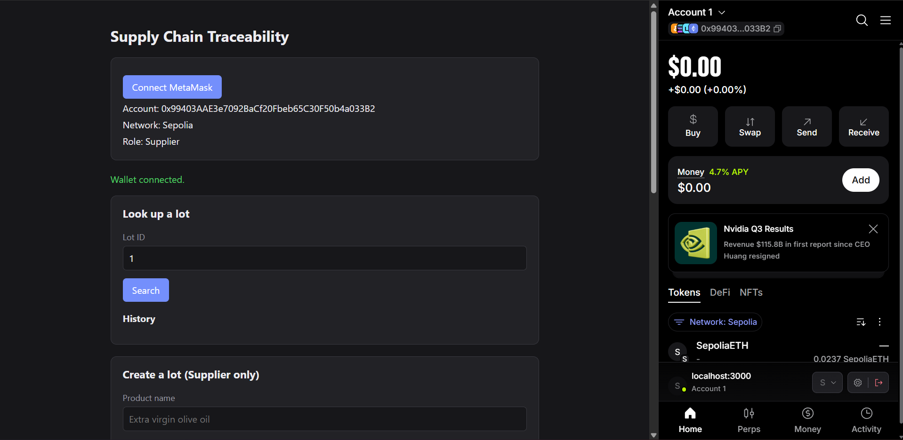
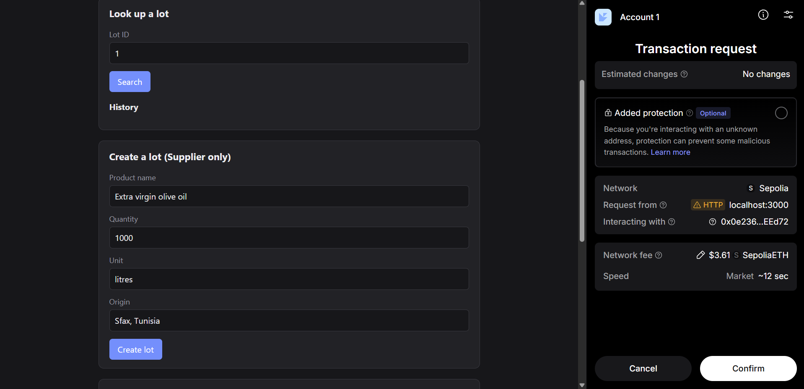
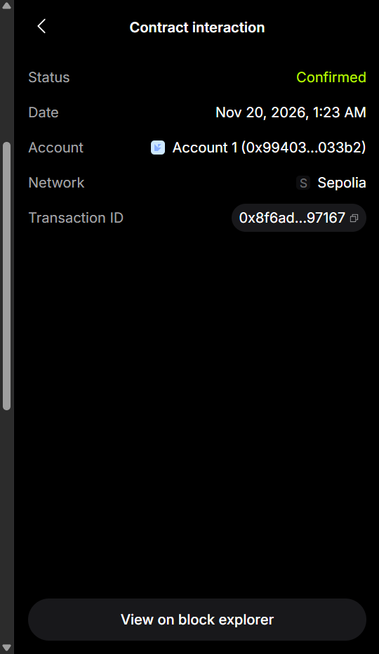
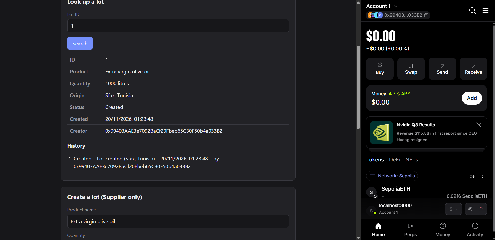
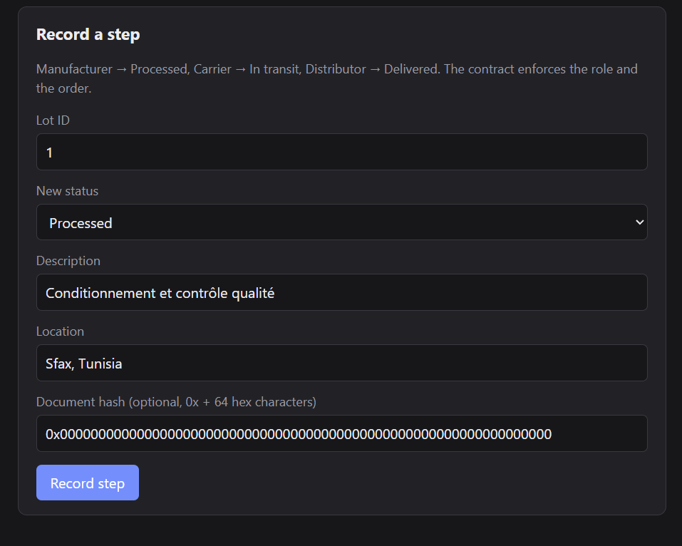
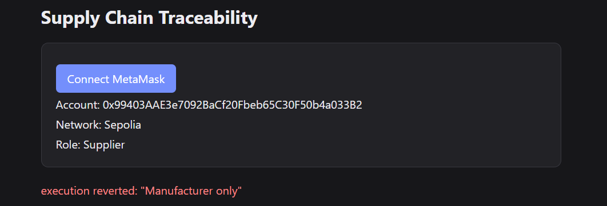

# 06 – Web3 Interface

This document covers TP sections 11 and 12. A small web application was built with HTML, CSS and JavaScript so that a user can interact with the `SupplyChain` contract deployed on Sepolia through MetaMask, without using Remix.

The interface lets a user connect a wallet, look up a lot and its full history, create a lot, and record a step.

## 1. Project structure

```
frontend/
├── index.html   page structure and forms
├── style.css    layout, light and dark theme
├── config.js    contract address, chain ID
├── abi.js       contract ABI (human-readable format)
└── app.js       wallet connection and contract calls (Ethers.js)
```

The contract address is public blockchain data and is the only deployment-specific value stored in the project. No private key or recovery phrase is used anywhere: all transactions are signed inside MetaMask.

## 2. Technologies

| Technology | Role |
|---|---|
| HTML, CSS, JavaScript | User interface, without a build step |
| Ethers.js 6.13.5 (CDN, pinned version) | Connection to the wallet and calls to the contract |
| MetaMask | Account management and transaction signing |
| `npx serve` | Local development server |

The Ethers.js version is pinned in the script URL so that a new release cannot silently change the behavior of the application.

## 3. Configuration and running

1. `config.js` holds the address of the contract deployed on Sepolia (`0x0e236F0C90e51D4Fe4fd829522C306543EAEEd72`) and the expected chain ID (11155111).
2. The folder is served locally instead of opening the HTML file directly, because wallet extensions work more reliably on a real origin:

   ```bash
   cd frontend
   npx serve
   ```

3. The page is opened at `http://localhost:3000`.

Brave's built-in wallet can take over the browser's wallet interface. To use MetaMask in Brave, the default wallet in `brave://settings/web3` has to be set to MetaMask.

## 4. How the interface works

### Connecting the wallet

When the user clicks **Connect MetaMask**, the application:

1. checks that a wallet is available and that the contract address is configured;
2. requests access to the accounts;
3. creates an Ethers `BrowserProvider` and checks that the active network is Sepolia (chain ID 11155111), refusing to continue otherwise;
4. gets a signer and creates the contract object from the address and the ABI;
5. reads the connected account's role with `roles(address)` and displays it.

The page reloads if the user changes account or network, so the displayed state never refers to a previous account.



### Looking up a lot

The lookup calls `getLot`, `getHistoryCount` and then `getHistoryStep` for each index. It displays the product, quantity, origin, status, creation date and creator, followed by the history: status, description, location, date and the address of the actor for each step, plus the document hash when one was recorded. Reading does not cost gas.

All values coming from the blockchain are inserted with `textContent` and never as HTML, so a malicious string stored in a lot (for example a product name containing HTML) cannot run code in the page.

### Creating a lot

The form sends `createLot(productName, quantity, unit, origin)`. Before sending, the page checks that the fields are filled and that the quantity is a positive whole number. After the transaction is confirmed, the lot ID is read from the `LotCreated` event in the transaction receipt, instead of assuming it is the last ID. The new ID is then copied into the lookup and step forms.





### Recording a step

The form sends `recordStep(lotId, newStatus, description, location, documentHash)`. The document hash is optional: if it is left empty, 32 zero bytes are sent, and if it is filled, it must be `0x` followed by 64 hexadecimal characters.

The form is not a security mechanism. The contract itself checks the role of the caller and the order of the statuses, so a user who bypasses the page and calls the contract directly is subject to the same rules.

## 5. Tests on Sepolia

| Test | Result |
|---|---|
| Connect the wallet | Account, network (Sepolia) and role (Supplier) displayed |
| Create a lot (Extra virgin olive oil, 1000 litres, Sfax, Tunisia) | Transaction confirmed on Sepolia |
| Look up lot 1 | Data read back from the blockchain; status Created; one history step with the creator's address and timestamp |



The transaction fee for creating the lot was `0.002058` Sepolia ETH, to be compared with the deployment fee of 0.0263 ETH. These values are collected for the evaluation section.

### Rejection of a forbidden operation

<!-- Keep this subsection only if you ran this test; otherwise delete it -->

A step was recorded with the Supplier account, which does not have the Manufacturer role needed for the Processed status. The contract rejected it with `Manufacturer only`, which confirms that the role rules also apply when the contract is used through the interface.




## 6. Limitations

- **Single account tested.** Only the deployer account (Supplier) was used on Sepolia. The Manufacturer, Carrier and Distributor steps through the interface would need additional funded accounts with assigned roles. The full cycle was validated on the local Remix VM and is covered by the automated tests planned with Hardhat.
- **Manual ABI.** The ABI in `abi.js` is written by hand from the contract. If the contract changes, it has to be updated, or replaced by the ABI exported by the compiler.
- **Wallet needed to read.** The lookup uses the wallet's provider, so a visitor without a wallet cannot view a lot. A read-only RPC connection would remove this requirement.
- **Manual lot lookup.** Lots are found by ID only. A dashboard that lists lots from the contract events, a visual timeline and a QR code for traceability are natural extensions.
- **No roles management screen.** `assignRole` is not exposed in the interface and is still done from Remix.

## Next

The next step is to set up Hardhat, so that the manual tests from the previous documents become automated tests that can be re-run after any change.
