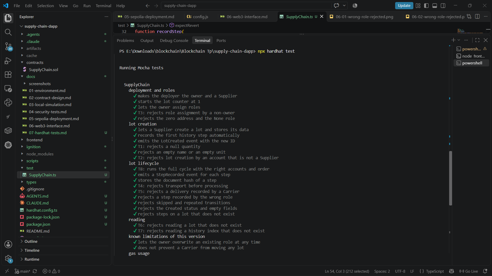
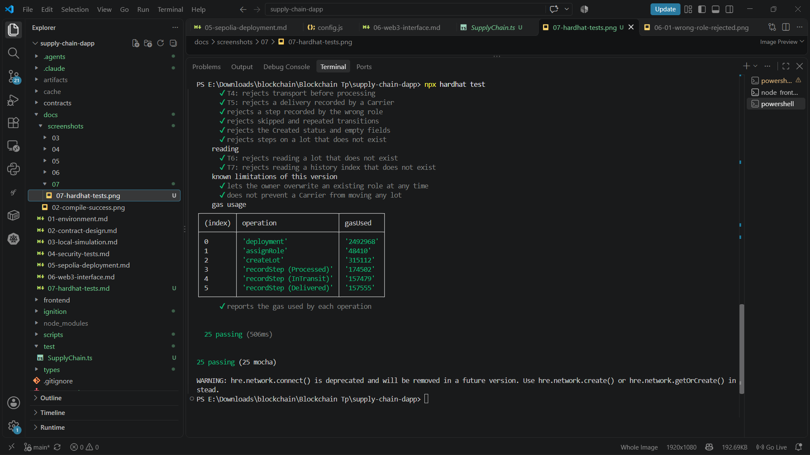

# 07 – Automated Tests with Hardhat

This document covers TP section 13. The manual tests done in Remix (see `03-local-simulation.md` and `04-security-tests.md`) were turned into automated tests with Hardhat, so that the whole behavior of the contract can be checked again with a single command after any change.

## 1. Environment

| Item | Value |
|---|---|
| Hardhat | 3.22.0 |
| Template | Mocha and Ethers.js (TypeScript) |
| Solidity compiler | 0.8.34 (EVM target: osaka) |
| Test library | Mocha with Node's `assert` module |
| Test file | `test/SupplyChain.ts` |

## 2. Setup

1. Hardhat was initialized in the repository root with `npx hardhat --init`, choosing the Mocha and Ethers template. The existing `README.md` and `.gitignore` were not overwritten.
2. The dependencies were installed with `npm install --save-dev ...` (the command printed by the initialization step).
3. The sample project files created by the template were removed and replaced by the project's own contract and tests.
4. The contract was compiled with `npx hardhat compile`, then the tests were run with `npx hardhat test`.

Each test starts from a freshly deployed contract, so tests do not depend on each other or on their execution order. Hardhat provides several simulated accounts, used as follows:

| Account | Role in the tests |
|---|---|
| 1 | Owner and Supplier (the deployer) |
| 2 | Manufacturer |
| 3 | Carrier |
| 4 | Distributor |
| 5 | Stranger with no role |

## 3. Results

All 25 tests pass, in about half a second.

| Group | Tests | What is checked |
|---|---|---|
| Deployment and roles | 5 | Deployer is owner and Supplier; lot counter starts at 1; owner assigns roles; non-owner is rejected (T3); zero address and `None` role are rejected |
| Lot creation | 6 | Lot data stored; first history step created automatically; `LotCreated` event; null quantity rejected (T1); empty name or unit rejected; non-Supplier rejected (T2) |
| Lot lifecycle | 9 | Full cycle with the right accounts (T8); `StepRecorded` event; document hash stored; transport before processing rejected (T4); delivery by a Carrier rejected (T5); wrong roles rejected; skipped and repeated transitions rejected; `Created` status and empty fields rejected; unknown lot rejected |
| Reading | 2 | Unknown lot rejected (T6); invalid history index rejected (T7) |
| Known limitations | 2 | The owner can overwrite a role; a Carrier can move any lot |
| Gas usage | 1 | Gas consumed by each operation |

### Coverage of the TP checklist

| TP checklist item | Covered by |
|---|---|
| The deployer is the owner | "makes the deployer the owner and a Supplier" |
| Roles are correctly assigned | "lets the owner assign roles" |
| The Supplier can create a lot | "lets a Supplier create a lot and stores its data" |
| The Manufacturer can prepare it | Full cycle (T8) |
| The Carrier can record the departure | Full cycle (T8) |
| The Distributor can confirm delivery | Full cycle (T8) |
| Forbidden operations fail | T1 to T7 and the additional rejection tests |
| The history contains the expected steps | Full cycle (T8), which checks actor and status of each of the four steps |

## 4. Tests that document limitations

Two tests do not check that a feature works. They show that two weaknesses described in the design document really exist in this version:

- **The owner can overwrite an existing role at any time.** After a Manufacturer account is reassigned as a Distributor, it can no longer record a Processed step. The contract has no revocation process, no delay and no multi-signature protection.
- **A Carrier can move any lot.** Roles are global and not assigned per lot, so a Carrier can take charge of a lot that was never assigned to it.

A production version would need to change these behaviors, and these tests would then have to be updated.

## 5. Gas usage

The last test measures the gas used by each operation on the local Hardhat network.

| Operation | Gas used |
|---|---|
| Deployment | 2,492,968 |
| `assignRole` | 48,410 |
| `createLot` | 315,112 |
| `recordStep` (Processed) | 174,502 |
| `recordStep` (InTransit) | 157,479 |
| `recordStep` (Delivered) | 157,555 |

The cost of an operation is the gas used multiplied by the gas price, so the fee depends on the network conditions at the time. These local figures are deterministic and repeatable, but they do not predict the costs on a public network. They are compared with the measurements made on Sepolia in the evaluation document.

`createLot` is the most expensive operation, because it writes the lot and its first history step, both containing text strings, into the storage. This supports the recommendation of the architecture document to keep long text and documents off-chain and store only identifiers, states and hashes on-chain.

## 6. Problems encountered

- **TypeScript errors right after initialization.** About 39 errors appeared in `tsconfig.json` and in the test file. The cause was that the dependencies had not been installed: the initialization step offered to install them and the answer was no. Running the printed `npm install` command fixed most of the errors.
- **Four remaining typing errors** (`recordStep`, `assignRole` and `createLot` "does not exist on type BaseContract"). Hardhat generates the typed contract definitions during compilation, so these errors disappeared after the first `npx hardhat compile` and a restart of the TypeScript server.
- **Deprecation warning.** Hardhat prints that `network.connect()` is deprecated in favor of `network.create()` or `network.getOrCreate()`. It does not affect the results.
- **Audit warnings.** `npm install` reported vulnerabilities in development dependencies. These packages only run on the developer's machine (compiler, test runner) and are not part of the deployed contract or the web interface. Forced upgrades were not applied, to avoid breaking the Hardhat toolchain.

## 7. What is not tested

- Role revocation and administration changes, since this version of the contract does not implement them.
- Simultaneous calls from several accounts.
- Gas costs on a public network (measured separately on Sepolia).
- The web interface, which was tested manually (see `06-web3-interface.md`).
- A full security audit: these tests show that the access-control and transition rules work for the listed cases, nothing more.

## Next

The next step is the evaluation: measuring operations on Sepolia, comparing them with the local figures, and discussing the architecture and limits of a real industrial deployment.
