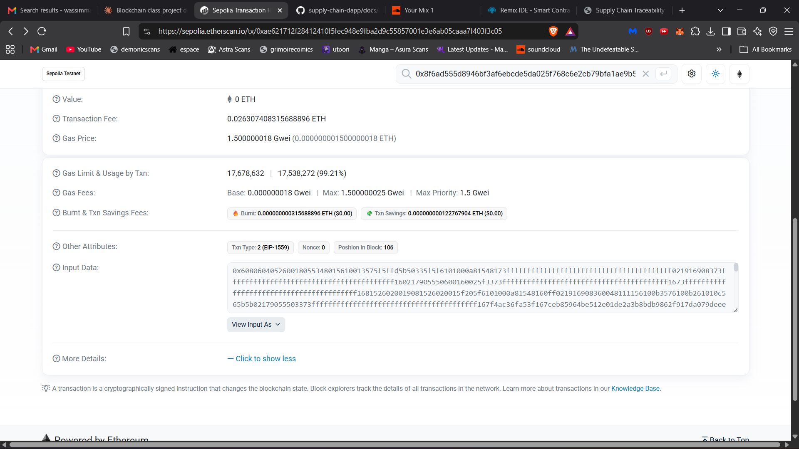
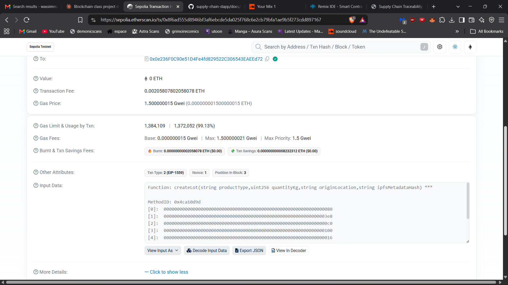
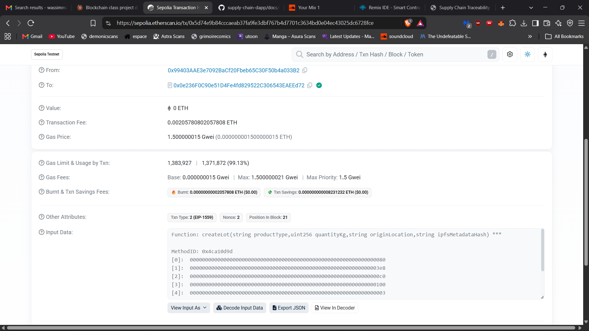
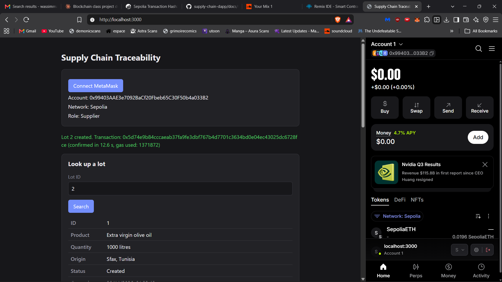
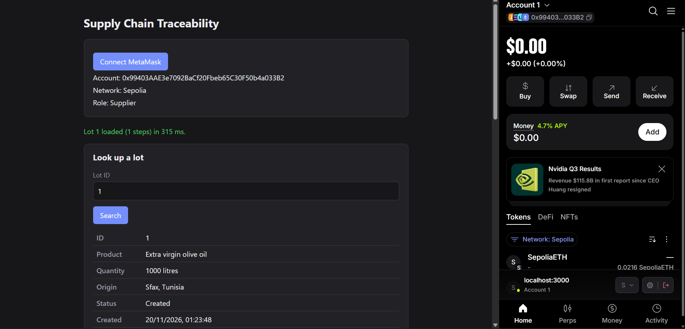

# 08 – Evaluation

This document covers TP section 15. It measures the prototype with reproducible scenarios, first on the local Hardhat network, then on the Sepolia test network, using the indicators proposed by the TP.

## 1. Method

| Source | Used for |
|---|---|
| Hardhat test suite (`test/SupplyChain.ts`) | Local gas, rejection tests, completeness of the full cycle |
| Web interface (`frontend/`) | Confirmation time of a transaction and duration of a lot lookup on Sepolia, measured with `performance.now()` in the browser |
| Sepolia Etherscan | Gas used, gas price and fee of the real transactions |

The measurements are small in number: this is a prototype evaluation on a test network with a single funded account, not a performance benchmark.

## 2. Measured indicators

| Indicator | Method | Result |
|---|---|---|
| Time to create a lot | Time between the broadcast of the transaction and its confirmation | **12.6 s** on Sepolia (1 measurement). Local network: effectively instant, the 25 tests including 25 contract deployments run in about 0.5 s in total |
| Verification time | Duration of reading a lot and its history | **563 ms, 468 ms and 315 ms** on Sepolia (mean about 449 ms) for a lot with one history step |
| Cost of an operation | Gas used multiplied by gas price | See section 3 |
| Success rate | Valid transactions executed / valid transactions submitted | **3 / 3 (100%)** on Sepolia: the deployment and two `createLot` calls |
| Detection of violations | Forbidden operations correctly rejected | **23 / 23** in the Hardhat tests |
| Completeness of traceability | Expected steps actually recorded | **4 / 4** steps in the full cycle on the local network. On Sepolia, **1 / 4** per lot, because only the Supplier account exists there and the later steps were not run |
| Resistance to errors | Results of role, state and invalid-data tests | **25 / 25** tests pass |

### Reading the times

- The confirmation time of 12.6 s is close to the roughly 12 seconds that MetaMask announced for the transaction before it was sent, which matches Ethereum's block interval. The time to create a lot is therefore dominated by the network and not by the contract.
- A lookup takes a fraction of a second. It involves three read calls (`getLot`, `getHistoryCount`, `getHistoryStep`), so the duration most likely reflects the round trips to the node used by the wallet more than the contract. Reading does not cost any gas.

## 3. Cost of operations

The cost of an operation is the gas used multiplied by the gas price. On Sepolia the gas price was 1.5 Gwei for all the measured transactions.

### Sepolia

| Operation | Transaction | Gas used | Fee (Sepolia ETH) |
|---|---|---|---|
| Deployment | `0xae621712...3c05` | 17,678,632 | 0.0263074 |
| `createLot` (lot 1) | `0x8f6ad555...7167` | 1,384,109 | 0.0020581 |
| `createLot` (lot 2) | `0x5d74e9b8...6728fce` | 1,383,927 | 0.0020578 |

Test ETH has no monetary value, so these fees are only meaningful for comparing operations with each other.

### Local network (Hardhat)

| Operation | Gas used |
|---|---|
| Deployment | 2,492,968 |
| `assignRole` | 48,410 |
| `createLot` | 315,112 |
| `recordStep` (Processed) | 174,502 |
| `recordStep` (InTransit) | 157,479 |
| `recordStep` (Delivered) | 157,555 |

`assignRole` and `recordStep` were not measured on Sepolia, since only one account with roles was available there.

### Local compared with Sepolia

| Operation | Local gas | Sepolia gas | Ratio |
|---|---|---|---|
| Deployment | 2,492,968 | 17,678,632 | about 7x |
| `createLot` | 315,112 | about 1,372,000 | about 4.4x |

The same contract used much more gas on Sepolia than on the local network. This is the main finding of this evaluation. The most likely explanation is a difference in gas pricing rules between the two environments: the local Hardhat network applies the older rules, while Sepolia was running the Glamsterdam upgrade at the time of the tests, which includes EIP-8037, a repricing that makes operations creating new permanent state (deploying code, writing new storage slots) more expensive. The pattern fits this explanation, since deployment and `createLot` are the operations that write the most new state. This explanation was not verified by an experiment, for example by running the tests on a local fork with the new rules, and it is not claimed to apply to Ethereum mainnet.

It confirms the warning of the TP: results obtained on a local network cannot predict costs on a public network.

### Effect of the size of the text

Lot 1 (`Extra virgin olive oil`, `Sfax, Tunisia`) and lot 2 (`Oil`, `Monastir, Tunisia`) consumed almost the same gas (a difference of 180 gas), although the product name of lot 2 is much shorter. A plausible reason is that short strings each fit in a single storage slot, so the cost depends on how many slots are written and not on the exact number of characters, as long as the strings stay short. Longer texts would use more slots and cost more, which supports keeping long descriptions and documents off-chain and storing only identifiers, states and hashes on-chain.

## 4. Observations

- **Correctness:** all the rules of the contract hold in the automated tests, and the interface reads back on Sepolia what was written.
- **Latency:** the cost in time of using a public blockchain is about one block per write operation (around 12 s), while reads are fast.
- **Cost:** writing text to the blockchain is the expensive part, and it is sensitive to the gas rules of the network, which can change with protocol upgrades.
- **Traceability:** the history is complete when all actors take part, but nothing in the evaluation shows that the physical facts entered are true. The contract guarantees integrity and attribution of records only.

## 5. Limits of this evaluation

- Few measurements: a single confirmation time and three lookup times, so no statistical conclusion can be drawn.
- Only the Supplier account was used on Sepolia, so `assignRole` and `recordStep` costs and the completeness of a full cycle were not measured there.
- The Sepolia gas price (1.5 Gwei) reflects a test network with low demand and says nothing about the fees of a busy public network.
- Lookup times depend on the connection and on the node used by the wallet.
- No load test (many simultaneous users or lots) was performed.

## Next

The next document discusses the architecture of an industrial version: what to store on-chain and off-chain, how to govern roles, and which risks remain.
