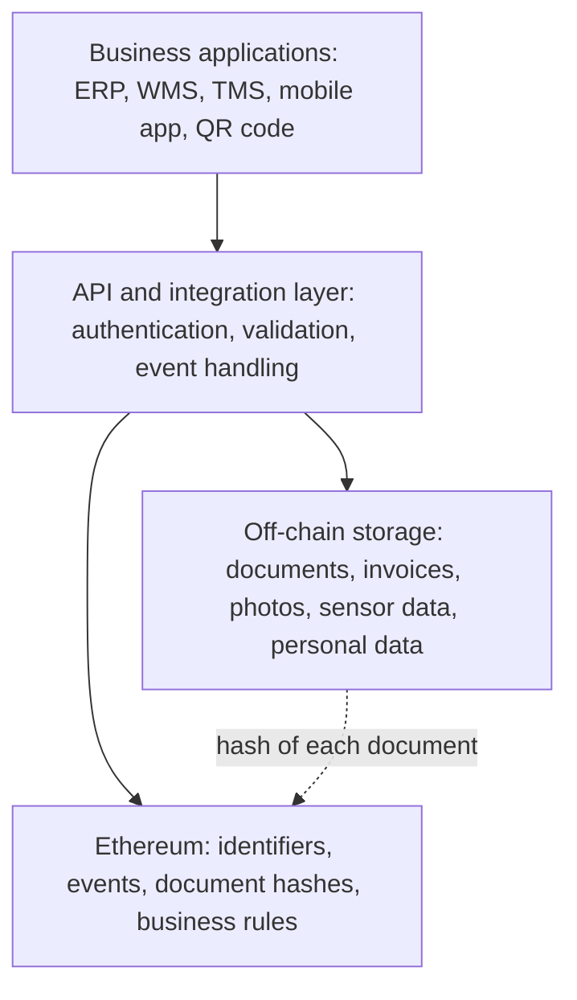

# 09 – Towards an Industrial Architecture

This document covers TP section 14. The prototype built in this project uses a single contract and stores text directly on Ethereum. That choice makes learning easier, but it is not necessarily suitable for a large-scale supply chain. This document explains what an industrial version would change, using what was observed during the project.

## 1. From the prototype to a layered architecture

In the prototype, the web page talks directly to one smart contract, and the contract stores everything. In an industrial setting, the blockchain would only be one layer among several.

| Layer | Components and functions |
|---|---|
| Business applications | ERP, WMS, TMS, mobile application, QR code scanning |
| API and integration | Authentication, validation of the data, handling of blockchain events, retry of failed transactions |
| Off-chain storage | Documents, invoices and large data, kept in secured storage |
| Ethereum | Identifiers, state transitions, events, document fingerprints and business rules |

The business applications keep working as they do today. The blockchain is added as a shared, tamper-evident record of key events, and the other systems write to it through the integration layer instead of each user dealing with wallets and gas.

## 2. What to store on the blockchain

| Data | Recommended storage | Reason |
|---|---|---|
| Lot identifier | Blockchain | Small, needs to be shared and stable |
| State and history of transitions | Blockchain | This is the core of the traceability |
| Ethereum address of the actor | Blockchain, if justified | Gives attribution, but is a persistent identifier |
| Fingerprint (hash) of a certificate | Blockchain | Proves integrity of a document stored elsewhere |
| Complete invoice | Secured off-chain storage | Large, confidential and possibly subject to regulation |
| Personal contact details | Protected database | Must be modifiable and deletable, which a blockchain does not allow |
| Photos, videos, sensor readings | Off-chain storage, optional hash on-chain | Too large and costly to store on-chain |
| Detailed ERP data | Business database, with verifiable references | Already managed by existing systems |

Any data written to a public blockchain can remain accessible forever. Personal data, trade secrets and confidential documents must not be placed there without a prior analysis. Even a hash of personal data can raise questions, so it also has to be assessed.

### Evidence from this project

The evaluation gives a practical reason for this recommendation:

- Writing a lot with its text fields (`createLot`) consumed about 1.37 million gas on Sepolia, around 4.4 times more than on the local network. The deployment consumed about 7 times more. These two operations are the ones that write the most new data into the blockchain state.
- The measured difference is most likely linked to a repricing of state creation on Sepolia. A design that writes less text on-chain is less exposed to this kind of change in the cost rules of the network.
- Lots with short and long texts consumed almost the same gas, but longer texts would require more storage slots and cost more.

In a lighter design, `createLot` would receive an identifier and a hash of a metadata record stored off-chain, instead of four text fields.

## 3. Governance of the system

The prototype hides several decisions behind a simple `owner`. An industrial system has to answer them explicitly.

| Question | Limitation in the prototype | Possible approach |
|---|---|---|
| Who can register a lot? | Any account with the Supplier role | Roles managed by an authority shared between the partners |
| Who can modify or revoke a role? | The owner alone, at any time (tested in the Hardhat tests) | Role management contract, revocation function, and an administration account controlled by several people (multi-signature) with a delay before changes |
| Who validates the reception of goods? | The Distributor confirms alone | Two-step handover: the sender proposes the transfer and the receiver accepts it |
| What happens if the sender and the receiver disagree? | Nothing is foreseen | A disputed state, with a defined procedure and a role allowed to resolve it |
| How to correct an error without erasing the history? | Not possible; steps are final | Append-only corrections: a new step or event that refers to the erroneous one |
| Who pays the gas fees? | Each account pays for its own transactions | Each partner, or the integration layer paying for the users through a relayer |
| What if an actor loses access to their wallet? | The role stays attached to a lost address | Procedure to reassign the role to a new address, with hardware wallets and key backup |

### Weaknesses seen in the tests

Two limitations were demonstrated by automated tests:

1. **The owner can overwrite any role at any time.** An attacker who controls the owner key controls the whole system. The owner should be a multi-signature account, and role changes should be logged and delayed.
2. **A Carrier can move any lot.** Roles are global. A handover with acceptance, or the assignment of a Carrier to each lot, would restrict an actor to the lots that concern them.

Audited access-control libraries exist, such as OpenZeppelin's role-based and two-step ownership contracts, and are a better starting point than a hand-written owner check for a production system.

## 4. Public blockchain or not

Ethereum's public network makes data visible and the system independent of any single company, but it also exposes commercial information and adds variable fees. If the partners do not want their data to be public, the options to evaluate are:

- a **permissioned network**, where only approved participants can read and write (for example a network based on Hyperledger Besu or Hyperledger Fabric);
- a **layer 2 network**, which reduces the cost of operations while still anchoring its records on Ethereum;
- keeping data off-chain and publishing only **hashes** on a public network.

The choice depends on who must be able to verify the records, the confidentiality of the data, the volume of transactions and who operates the infrastructure.

## 5. The truth of the data entered

The blockchain makes records verifiable but cannot check the physical world. A reading from a sensor, a QR code scan or an ERP entry can be false or wrong before it reaches the contract. To limit this risk:

- sensors and devices should sign their readings, and the signature should be verified;
- physical controls, such as inspections and seals, remain necessary;
- certificates should come from trusted issuers, and their validity must be checked off-chain;
- the actors responsible for each entry are identifiable through their addresses, which allows accountability if something is wrong.

## 6. Summary of recommendations

1. Store identifiers, states, events and hashes on-chain, and everything else off-chain.
2. Replace the single owner with controlled administration: multi-signature, revocation, delay and a log of rights changes.
3. Restrict actors to the lots that concern them, with a two-step handover.
4. Define disputes, corrections and key-loss procedures before going live.
5. Choose the type of network according to confidentiality and cost, and measure it again, since the cost rules of a network can change.
6. Have the contract audited before any real use.

## Next

The last step is the project README: an overview, how to run the contract, the tests and the web interface, a summary of the results and the limits of the prototype.
